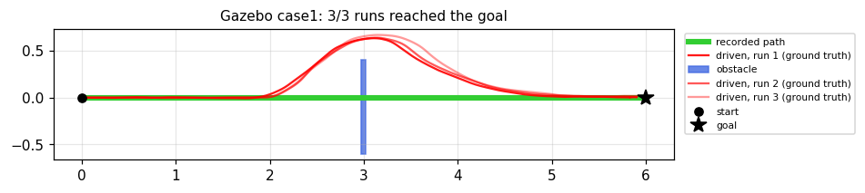
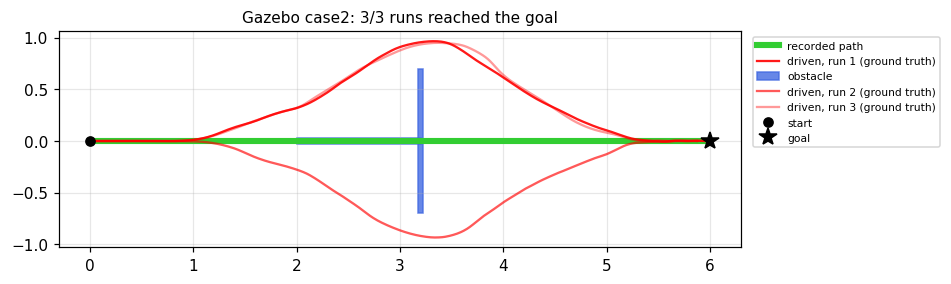
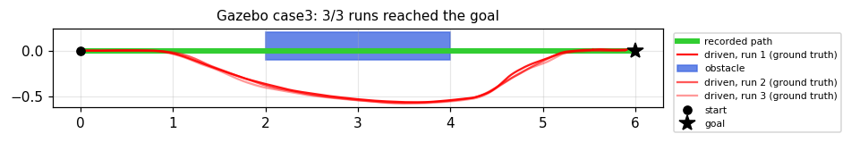
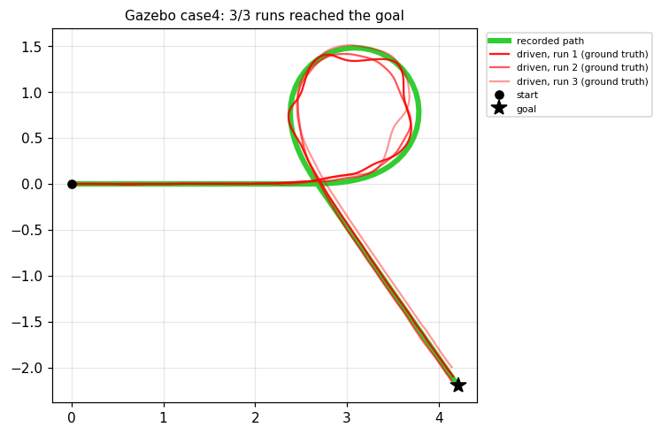
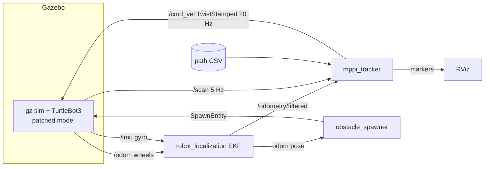

# mppi_nav: MPPI path tracking with lidar obstacle avoidance (TurtleBot3, ROS 2 Jazzy)

A pure-Python ROS 2 package that **records a path** by teleoperation and **replays it with an
MPPI (Model Predictive Path Integral) controller**. The robot goes around static and dynamic
obstacles seen by the 360° lidar and then **returns to the recorded path**. It replaces the
Regulated Pure Pursuit tracker of the reference repo
([manojkarnekar/smoothing-rpp](https://github.com/manojkarnekar/smoothing-rpp)), which stops and
waits whenever something is in front of it.

## 🎬 Demo videos
<!-- To add a video: edit this README on GitHub and drag the video file onto the line under its
     heading (GitHub uploads it and inserts the link), or paste a YouTube / Google Drive link. -->

### Case 1: thin wall across the path (static obstacle)
The robot goes round the short end of the wall and returns to the recorded path.

_Video coming soon_

### Case 2: symmetric T (static obstacle)
The T's leg lies on the path: the robot leaves the path early, runs alongside the leg, rounds an
end of the cross bar and rejoins.

_Video coming soon_

### Case 3: long box on the path (static obstacle)
A long detour round a 2 m box without stopping, then back onto the path.

_Video coming soon_

### Case 4: recorded self-crossing path
A complicated path that crosses itself is replayed in order, with no shortcut at the crossing.

_Video coming soon_

### Dynamic obstacle avoidance
Boxes are dropped on the path in front of the moving robot; it goes round each one and rejoins.

_Video coming soon_

| Case 1: thin wall | Case 2: symmetric T | Case 3: long box | Case 4: self-crossing loop |
|---|---|---|---|
|  |  |  |  |

_Gazebo runs, three per case, plotted from Gazebo's ground-truth pose: green = recorded path,
red = driven path, blue = obstacles._

---

## Contents
1. [Features](#features)
2. [Install and build](#install-and-build)
3. [Run it](#run-it)
4. [How it works](#how-it-works)
5. [MPPI in detail](#mppi-in-detail)
6. [Results](#results)
7. [Testing](#testing)
8. [Package layout](#package-layout)

---

## Features
- **Path recorder**: points exactly **0.1 m** apart, saved to CSV (`x,y`, the same format as the reference repo).
- **MPPI tracker**: 1000 sampled 5.1 s futures every 50 ms (20 Hz), fully vectorised NumPy. Its core
  (`mppi_core.py`) has **no ROS imports**, so it is unit-tested and tuned offline.
- **Lidar obstacle avoidance** with return to the path. Static obstacles (Cases 1–3) and
  **dynamic** ones dropped in front of the moving robot.
- **Self-crossing paths are followed in order** (Case 4): a monotonic progress index plus a
  per-rollout forward-only path match, so there are no shortcuts at crossings.
- **One-command launch**: `case:=case1` loads the path and its obstacle world. `path:=<csv>` replays any recording.
- **Robust state estimation**: an EKF (wheel odometry + IMU gyro) and a fixed robot model (frictionless caster).
- **RViz**: recorded path (green), traversed path (red), obstacle points (blue), MPPI optimal
  rollout (yellow), sampled rollouts (grey), progress point (magenta).
- **Evaluation tooling**: an offline 2D simulator (`sim2d/`) and a Gazebo batch evaluator
  (`tools/gz_eval.py`) that scores every run against Gazebo's ground truth.

## Install and build
Tested on **Ubuntu 24.04 (WSL2) + ROS 2 Jazzy + Gazebo Harmonic**, TurtleBot3 **burger**.

```bash
sudo apt install ros-jazzy-turtlebot3 ros-jazzy-turtlebot3-simulations ros-jazzy-turtlebot3-msgs \
                 ros-jazzy-robot-localization ros-jazzy-ros2run python3-scipy python3-matplotlib
mkdir -p ~/ros2_ws/src && cd ~/ros2_ws/src
git clone https://github.com/AmeyaB2005/MPPI_nav.git mppi_nav
cd ~/ros2_ws
source /opt/ros/jazzy/setup.bash
colcon build --packages-select mppi_nav --symlink-install
source install/setup.bash
export TURTLEBOT3_MODEL=burger
```

## Run it
Every terminal needs `source /opt/ros/jazzy/setup.bash && source ~/ros2_ws/install/setup.bash && export TURTLEBOT3_MODEL=burger`.

### Test cases
```bash
ros2 launch mppi_nav mppi.launch.py case:=case1     # thin wall across the path
ros2 launch mppi_nav mppi.launch.py case:=case2     # symmetric T, leg on the path
ros2 launch mppi_nav mppi.launch.py case:=case3     # long box on the path (long detour)
ros2 launch mppi_nav mppi.launch.py case:=case4     # self-crossing loop, no obstacles
ros2 launch mppi_nav mppi.launch.py case:=dynamic   # boxes dropped in front of the moving robot
ros2 launch mppi_nav mppi.launch.py case:=loop      # self-crossing loop + dropped boxes
```
- The robot is spawned on the first path point, facing along the path. It **holds still until
  /odom, /scan and TF are live, then waits `start_delay` (10 s)** so Gazebo and RViz finish
  loading, then tracks. Start early with `ros2 service call /start_tracking std_srvs/srv/Trigger`.
- At the end it logs `Goal reached in … s` with MPPI timing and the closest lidar point, and
  writes the driven path to `results/<path>_traversed.csv`.

### Record your own path and replay it
```bash
# terminal 1
ros2 launch mppi_nav record.launch.py output:=my_path.csv
# terminal 2
ros2 run turtlebot3_teleop teleop_keyboard
# Ctrl+C in terminal 1 saves paths/my_path.csv (or: ros2 service call /save_path std_srvs/srv/Trigger)

ros2 launch mppi_nav mppi.launch.py path:=my_path.csv
```
Recording and replay use **the same world, robot model and EKF pose** (see
`mppi_nav/launch_utils.py`), so a recording and its replay share one frame.
`world:=/abs/path/my_world.sdf` works for both. The world must be named `default` and contain the
Physics, UserCommands, SceneBroadcaster, Sensors (ogre2) and Imu systems.

### Dynamic obstacles on any path
```bash
ros2 launch mppi_nav mppi.launch.py case:=case1 spawn:=auto     # a box every 8 s while moving
ros2 launch mppi_nav mppi.launch.py case:=case1 spawn:=manual   # only when you ask:
ros2 service call /drop_obstacle std_srvs/srv/Trigger
```
Boxes (0.25–0.4 m) land **on the path, 0.8–1.5 m ahead of the robot measured along the path**,
±0.15 m sideways. They are never dropped near the path end or within 0.8 m of another pass of the
path (see `config/obstacle_spawner.yaml`). The tracker sees them **only through the lidar**.

### Useful launch arguments (`mppi.launch.py`)
| Argument | Default | Meaning |
|---|---|---|
| `case` | – | `case1…case4`, `case4b`, `dynamic`, `loop`: path **and** world |
| `path` / `world` | – / `empty` | any CSV (absolute or in `paths/`) / any world (`worlds/<name>` or `.sdf` file) |
| `spawn` | `off` (`auto` for dynamic, loop) | dropped boxes: `off`, `auto`, `manual` |
| `use_ekf` | `true` | `false` = raw wheel odometry (for comparison) |
| `start_delay` | `10.0` | seconds to wait after all inputs are live |
| `gui`, `use_rviz` | `true` | headless runs: `gui:=false use_rviz:=false` |
| `x_pose y_pose yaw` | `auto` | override the spawn pose |

> After stopping a launch with Ctrl+C, Gazebo can leave server processes behind. Run
> `pkill -f '^gz sim'` before the next launch.

---

## How it works



**`mppi_tracker` (ROS node)**, every 50 ms:
1. Take the newest pose and predict it forward to *now* with the last command (latency compensation).
2. If a new scan arrived: turn it into obstacle points in the odom frame, using the **robot pose
   at the scan's timestamp** (the lidar is only 5 Hz).
3. `MPPIController.compute(state)` returns `(v, ω)`, published as `TwistStamped` (Jazzy's TB3 bridge type).
4. Publish markers. Stop safely if the pose or scan is older than 0.5 s.

**Frames.** Gazebo's odometry starts at (0, 0, 0) at the spawn pose, while the CSV is in the
world frame of the recording. The tracker therefore moves the path into the odom frame with the
spawn pose: `p_odom = R(-yaw0)(p_world - p0)`.

---

## MPPI in detail
All of this is in [`mppi_nav/mppi_core.py`](mppi_nav/mppi_core.py) (pure NumPy, no loops over samples).

**State and model.** State `x = (x, y, θ)`, control `u = (v, ω)`, unicycle with Euler steps of `dt = 0.15 s`:

$$x_{t+1} = x_t + v_t\cos\theta_t\,dt,\quad y_{t+1} = y_t + v_t\sin\theta_t\,dt,\quad \theta_{t+1} = \theta_t + \omega_t\,dt$$

All K rollouts are computed at once with cumulative sums over time, giving an array of shape (K, T, 3).

**One control cycle** (K = 1000 samples, T = 34 steps, a 5.1 s look-ahead):
1. **Sample.** $V_k = \mathrm{clip}(U + \varepsilon_k)$ with $\varepsilon_k \sim \mathcal N(0, \Sigma)$, $\Sigma = \mathrm{diag}(0.1^2, 0.6^2)$. The sample set also always contains:
   - the current plan $U$ itself and a "stop" sequence;
   - 10 % exploration samples drawn around zero;
   - 32 fixed "turn-and-go" primitives: full speed, turning at up to ±1.5 rad/s for 0.9 s or 1.5 s, then straight or turning back.
2. **Roll out** every $V_k$ with the model, giving trajectories $\tau_k$.
3. **Score** every trajectory: $S_k = \sum_t c(\tau_{k,t}, V_{k,t}) + \phi(\tau_{k,T})$ (cost terms below).
4. **Weight** the samples (softmin):
   $$w_k = \frac{\exp\!\big(-(S_k - \min_j S_j)/\lambda\big)}{\sum_i \exp\!\big(-(S_i - \min_j S_j)/\lambda\big)}$$
   Subtracting $\min S$ does not change the result, but it keeps `exp` from underflowing, and
   colliding samples (cost ≥ 10⁴) simply get weight ≈ 0.
5. **Update** the plan: $U \leftarrow \sum_k w_k V_k$. This weighted average of the sampled
   sequences equals $U + \sum_k w_k\varepsilon_k$ when nothing is clipped. Then smooth it with a
   Savitzky–Golay filter.
6. **Apply** $U_0$, then shift $U$ forward by one control period (0.05 s = ⅓ model step,
   by linear interpolation) as the warm start for the next cycle.

**What λ (temperature) does.** λ → 0 keeps only the single best sample: greedy and jumpy.
λ → ∞ averages all samples equally, so the plan barely moves. With our cost scale, **λ = 1.0**
was the best of {0.3, 1, 3}. It is also small enough that a "go left" and a "go right" plan are
not averaged into "straight into the wall".

### Cost terms (`config/mppi_params.yaml`)
| Term | Formula (per rollout) | Weight | Why |
|---|---|---|---|
| Tracking | $\sum_t d(p_t, \text{path})$ | `w_track = 5.0` | stay on the recorded path |
| Progress | $-\min(\text{idx}_T + \text{frac}, \text{cap})$ | `w_progress = 15.0` per 0.1 m | keep moving; never "park" in front of an obstacle |
| Heading | $\sum_t (1-\cos(\theta_t-\theta^{path}_t))$ | `w_heading = 1.0` | point along the path |
| Obstacle | $\sum_t e^{-(d_t - r_c)/0.1}$ for $d_t < 0.5$ m | `w_obstacle = 1.0` | soft clearance |
| Collision | $10^4\,(1 + n_{hit}/T)$ if any $d_t < r_c$ | `w_collision = 1e4` | hard limit, $r_c$ = 0.18 m = 0.105 m robot + 7.5 cm |
| Effort | $\sum_t \omega_t^2$ | `w_w = 0.05` (`w_v = 0`) | discourage needless turning |
| Smoothness | $\sum_t \Delta v_t^2,\ \Delta\omega_t^2$ | `w_dv = 1.0`, `w_dw = 0.1` | smooth commands (first Δ is against the last sent command) |
| Terminal | $\lVert p_T - p_{goal}\rVert$, only once the goal is in the window | `w_terminal = 1.0` | come to rest on the last point |

While the path ahead is blocked, tracking and heading are multiplied by `blocked_scale = 0.1`.

---

## Results

### Gazebo (3 runs per case, measured with Gazebo ground truth, `python3 tools/gz_eval.py`)
| Case | Goal reached | Time [s] | Min body clearance [m] | Collisions | CTE mean / max [cm]¹ | Coverage² [%] | Goal error³ [cm] | MPPI step mean / max [ms] |
|---|---|---|---|---|---|---|---|---|
| case1 (thin wall) | 3/3 | 35.6–38.9 | 0.109–0.139 | 0 | 2.1 / 25.0 | 84 | 8.1–10.6 | 30 / 91 |
| case2 (symmetric T) | 3/3 | 35.2–46.6 | 0.104–0.143 | 0 | 4.6 / 48.4 | 69–74 | 4.7–11.6 | 33 / 85 |
| case3 (long box) | 3/3 | 36.7–43.8 | 0.148–0.188 | 0 | 0.8 / 13.9 | 83–90 | 8.8–11.6 | 38 / 86 |
| case4 (self-crossing loop) | 3/3 | 58.1–60.0 | – | 0 | 3.6 / 24.2 | 94–100 | 8.8–20.9 | 30 / 72 |
| case4_recorded (teleop, sharp turns) | 3/3 | 41.7–45.9 | – | 0 | 8.7 / 45.5 | 53–90 | 28.9–49.4 | 25 / 63 |
| loop + dropped boxes | 3/3 | 44.4–56.8 | 0.150–0.168 | 0 | 1.9 / 18.7 | 78–81 | 2.5–13.6 | 45 / 137 |
| dynamic (curve + dropped boxes) | 3/3 | 41.6–56.0 | 0.072–0.153 | 0 | 8.1 / 41.3 | 73–86 | 11.1–41.3 | 47 / 123 |

¹ Only where the robot is > 1 m from every obstacle, i.e. after rejoining.
² Recorded path points (not under obstacles) that the robot passed within 15 cm.
³ Where the robot *really* stopped. The tracker stops within 0.1 m of its own estimate, so
anything beyond 10 cm is odometry drift accumulated during the run.

Per-run numbers: [`results/gazebo_metrics.md`](results/gazebo_metrics.md). Plots: `results/gz_<case>.png`.

---

## Testing
```bash
cd ~/ros2_ws/src/mppi_nav
python3 -m pytest -q test           # 32 unit tests (no ROS needed for mppi_core / utils)
python3 sim2d/run_all.py            # offline closed-loop runs + PNGs (sim2d/results/)
python3 tools/gz_eval.py --runs 3   # Gazebo batch evaluation (headless, ~25 min)
```
The unit tests cover:
- the unicycle step against a step-by-step loop;
- rollout shapes, and weights that sum to 1 and favour low cost;
- time-correlated noise statistics;
- the warm-start shift and the motion primitives;
- progress never going backward or jumping at a crossing;
- no progress for rollouts on a later lap;
- a colliding sample getting a high cost, and recovery when every sample collides;
- obstacle cropping and capping, and the goal stop;
- closed-loop straight-line tracking;
- YAML defaults matching the code;
- scan → point conversion, CSV I/O and 0.1 m recorder spacing.

---

## Package layout
```
mppi_nav/
├── mppi_nav/
│   ├── mppi_core.py         # MPPI controller: pure NumPy, no ROS (unit-tested)
│   ├── mppi_tracker.py      # ROS node: odom/scan in, cmd_vel + markers out
│   ├── path_recorder.py     # ROS node: records the pose every 0.1 m to CSV
│   ├── obstacle_spawner.py  # ROS node: drops boxes on the path ahead (dynamic tests)
│   ├── launch_utils.py      # shared simulation setup for both launch files
│   ├── utils.py             # CSV I/O, resampling, scan -> points (no ROS)
│   └── markers.py           # RViz Path / Marker helpers
├── launch/      record.launch.py, mppi.launch.py
├── config/      mppi_params.yaml, ekf.yaml, obstacle_spawner.yaml, bridge_no_tf.yaml, mppi.rviz
├── worlds/      case1-4, case4b, dynamic, loop, empty (.sdf, generated)
├── paths/       case CSVs + case4_recorded.csv (teleop recording)
├── sim2d/       offline simulator: world.py, scenarios.py (paths + worlds source), run_all.py
├── tools/       gz_eval.py (Gazebo batch evaluation with ground truth)
├── results/     Gazebo metrics and plots
└── test/        pytest unit tests
```
Regenerate paths and worlds after changing a scenario: `python3 sim2d/scenarios.py`.
